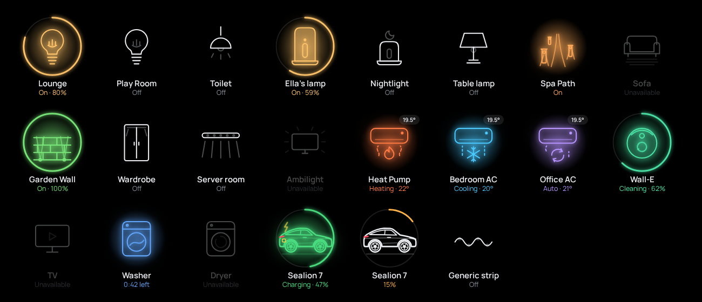
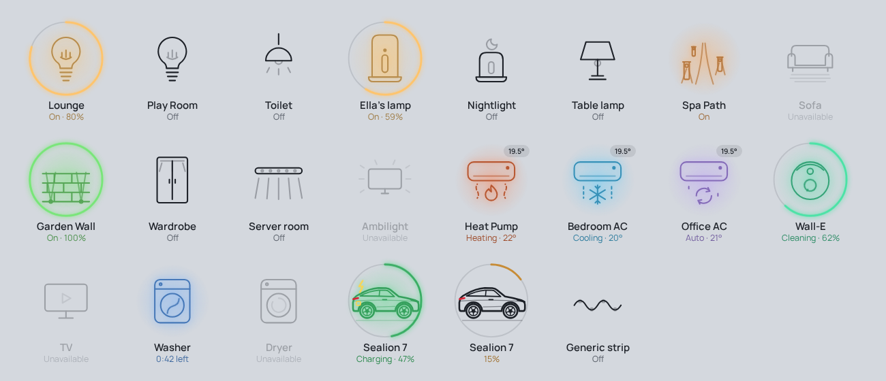
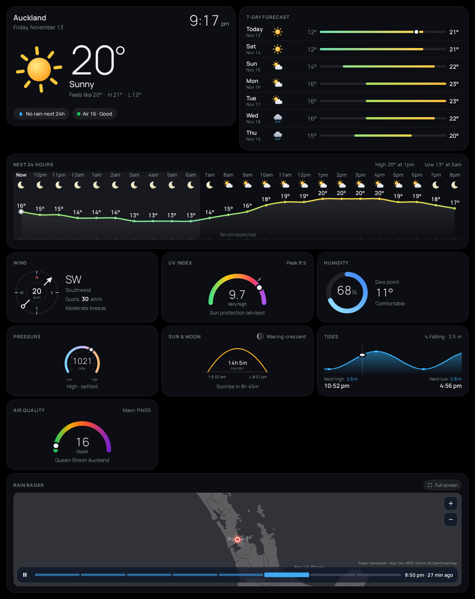
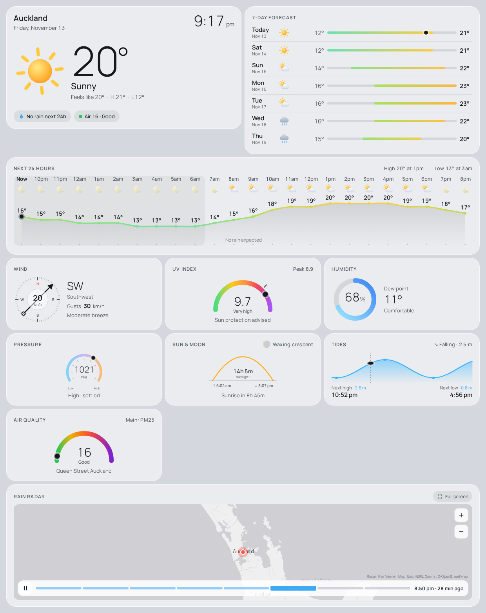

# KSH Cards (Kiwi Smart Home)

Modular dashboard cards for Home Assistant, built for wall tablets and phones.

- **Icon cards:** one card per device, drawn as large line art. White when off; when on, it glows in the device's own colour, with a thin ring for brightness, battery or progress.
- **Weather cards:** the weather page split into separate cards, so each screen can show only what it needs.

Every card follows your Home Assistant theme and light/dark mode. A matching **KSH theme** is included: muted grey by day, true black at night.

| Icons (dark) | Icons (light) |
|---|---|
|  |  |

| Weather (dark) | Weather (light) |
|---|---|
|  |  |

## Install

### Option 1: integration (recommended)

The `ksh_cards` integration serves the cards from inside Home Assistant and loads them on every dashboard. You don't need to add any Lovelace resources, and updating the integration updates every card.

1. Copy `custom_components/ksh_cards` into your Home Assistant `config/custom_components/` folder.
2. Restart Home Assistant.
3. Go to **Settings → Devices & services → Add integration**, search for **KSH Cards** and add it.
4. Refresh your browser (or restart the Kiosk Satellite app). The cards appear in the card picker under **KSH**.

To remove the cards, delete the integration and refresh.

### Option 2: dashboard resources

If you'd rather not install an integration:

1. Copy the two files from `custom_components/ksh_cards/www/` to `config/www/ksh/`.
2. Go to **Settings → Dashboards → ⋮ → Resources** and add both as **JavaScript module**:
   - `/local/ksh/ksh-icon-cards.js`
   - `/local/ksh/ksh-weather-cards.js`

Don't use both options at once.

### Theme (optional)

Copy `themes/ksh.yaml` to `config/themes/`, then reload themes. Pick **KSH** in your profile or per dashboard.

## Icon cards

Each icon is its own card, so you can place it on any dashboard and copy it between screens. Every card has a visual editor.

| Card | Drawing | Good for |
|---|---|---|
| `ksh-ceiling-light-card` | Bulb with filament | Ceiling and room lights |
| `ksh-pendant-light-card` | Pendant shade | Pendant lights |
| `ksh-bedside-lamp-card` | Cylinder lamp | Mi / Yeelight Bedside Lamp 2 and similar |
| `ksh-nightlight-card` | Short lamp with moon | Nightlights |
| `ksh-table-lamp-card` | Shade on a stand | Table lamps |
| `ksh-floor-lamp-card` | Arc floor lamp | Floor lamps |
| `ksh-path-lights-card` | Path with bollards | Garden and path lighting |
| `ksh-under-glow-card` | Sofa with glow below | Under-furniture LED strips |
| `ksh-wall-wash-card` | Brick wall with uplights | Retaining-wall and facade lights |
| `ksh-wardrobe-light-card` | Wardrobe with strip | Cupboard and wardrobe strips |
| `ksh-light-bar-card` | LED bar with wash | Light bars, under-cabinet strips |
| `ksh-led-strip-card` | Wave of LEDs | Any other LED strip |
| `ksh-ambilight-card` | TV with glow rays | Ambilight / screen sync lights |
| `ksh-heat-pump-card` | Wall unit | Climate entities. Colour and symbol show the mode: heat 🔥 orange, cool ❄ blue, dry/eco 🍃 green, auto ⟳ violet, fan grey |
| `ksh-vacuum-card` | Robot vacuum | Vacuums; the ring shows battery |
| `ksh-tv-card` | Television | TVs, media players, switches |
| `ksh-washer-card` | Washing machine | Appliance state sensors |
| `ksh-dryer-card` | Dryer | Appliance state sensors |
| `ksh-ev-car-card` | Coupe-SUV EV (BYD Sealion 7 style) | EV battery %. Ring shows charge; glows only while charging |
| `ksh-icon-card` | Choose with `icon:` | Any of the above |

### Example

```yaml
type: custom:ksh-heat-pump-card
entity: climate.living_room
```

```yaml
type: custom:ksh-ev-car-card
entity: sensor.car_battery_level
range_entity: sensor.car_range
charging_entity: binary_sensor.car_charging
```

### Options (all icon cards)

| Option | Default | What it does |
|---|---|---|
| `entity` | required | The device |
| `name` | entity name | Label under the icon |
| `icon` | per card | Drawing, for `ksh-icon-card` only: `ceiling-light`, `pendant-light`, `bedside-lamp`, `nightlight`, `table-lamp`, `floor-lamp`, `path-lights`, `under-glow`, `wall-wash`, `wardrobe-light`, `light-bar`, `led-strip`, `ambilight`, `heat-pump`, `vacuum`, `tv`, `washer`, `dryer`, `ev-car` |
| `color` | automatic | Colour when on. Lights use their real colour; white bulbs glow warm |
| `show_ring` | `true` | Ring for brightness, battery or progress |
| `show_state` | `true` | State line under the name |
| `tap_action` | `auto` | `auto`, `toggle`, `more-info`, `navigate`, `none`. Hold always opens more-info |
| `navigation_path` | — | Where `navigate` goes |
| `click_sound` | `true` | Short click on tap |
| `battery_entity` | — | Vacuum battery sensor |
| `range_entity`, `charging_entity` | — | EV range and charging sensors |
| `remaining_entity`, `progress_entity` | — | Appliance time left and progress % |

## Weather cards

| Card | Shows | Main options |
|---|---|---|
| `ksh-weather-now-card` | Location, date, clock, conditions, feels-like, high/low, chips for rain, air quality and warnings | `entity`, `feels_like_entity`, `aqi_entity`, `warnings_entity`, `show_clock`, `show_chips` |
| `ksh-weather-hourly-card` | Temperature curve, rain bars, night bands | `entity`, `hours` |
| `ksh-weather-daily-card` | Day-by-day forecast with range bars | `entity`, `days` |
| `ksh-rain-radar-card` | Animated rain radar, zoom and full-screen | `zoom`, `frames`, `latitude`, `longitude`, `show_fullscreen` |
| `ksh-wind-card` | Compass, speed, gusts, Beaufort | `entity`, `gust_entity` |
| `ksh-uv-card` | UV gauge with peak | `entity` or `uv_entity`, `peak_entity` |
| `ksh-air-quality-card` | AQI gauge | `entity` |
| `ksh-humidity-card` | Humidity ring, dew point | `entity`, `detail_entity` |
| `ksh-pressure-card` | Barometer | `entity` |
| `ksh-sun-moon-card` | Sun arc, daylight, moon phase | `entity` (`sun.sun`) |
| `ksh-tides-card` | Tide curve | `entity` (a tide sensor with `last_tide_*` / `next_tide_*` attributes, such as NIWA Tides) |

All weather cards also accept `title` and `transparent: true`. Weather entities that don't provide forecast attributes are subscribed to automatically.

See [`examples/weather-view.yaml`](examples/weather-view.yaml) for a complete page.

### Rain radar notes

- Radar images come from [RainViewer](https://www.rainviewer.com/api.html) and maps from Esri's free grey canvas. Neither needs an API key.
- RainViewer's free tiles stop at zoom 7, so higher zooms enlarge the radar while keeping the map sharp.
- RainViewer allows about 500 tiles per minute per internet connection. One radar uses roughly 60 to 100 tiles when it opens and a few each refresh. If the limit is hit, the card waits a minute and retries.

## Licence

[MIT](LICENSE). Anyone may use, copy, change, share and sell these cards, forever, provided the copyright notice stays with them.

This folder is licensed separately from the rest of the HA-Extras repository.

## Publishing through HACS

HACS installs integrations only from the root of a repository. To make KSH Cards installable through HACS, move this folder into its own repository (for example `thekiwismarthome/ksh-cards`). It's already laid out for that: `custom_components/`, `hacs.json`, `README.md` and `LICENSE` at the top level.
